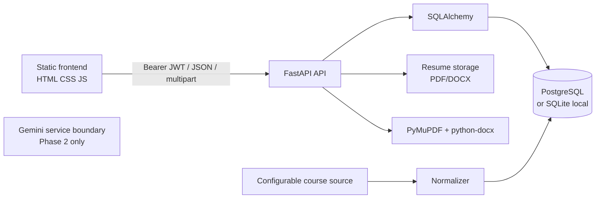
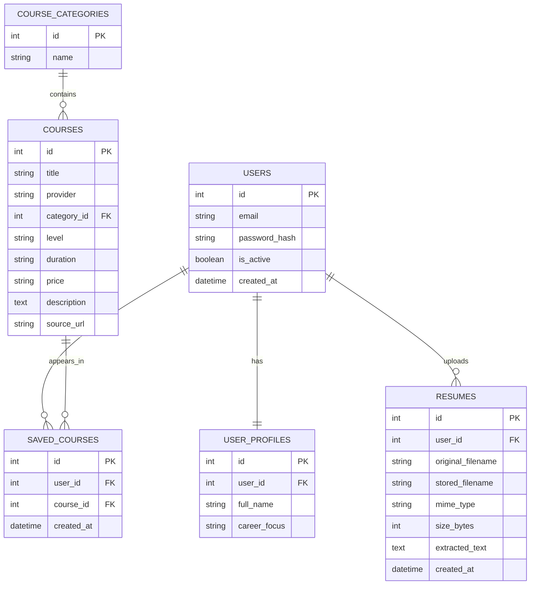

# CareerPilot — Phase 1 architecture

## System architecture

## ERD

## API boundary

The frontend calls `/api/auth`, `/api/me`, `/api/courses`, and `/api/resumes`. The API does not expose AI, jobs, internships, or interview routes in Phase 1. Those domains can be added without changing the Phase 1 entities.
