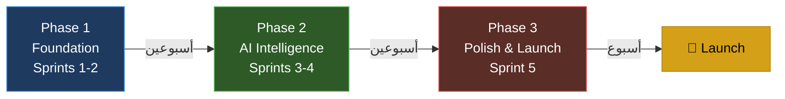
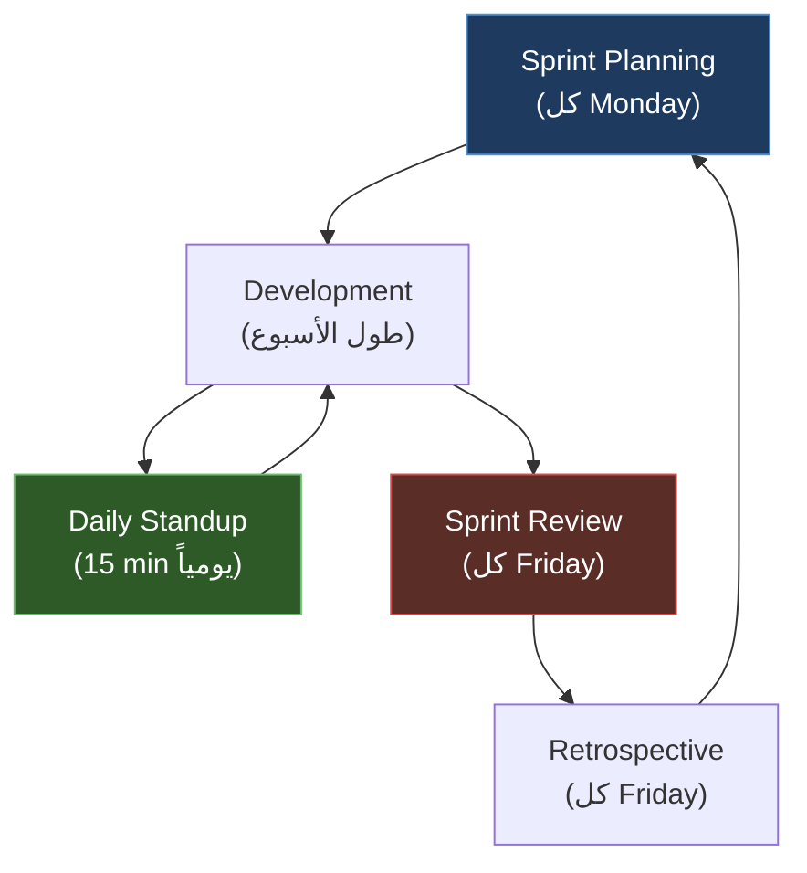
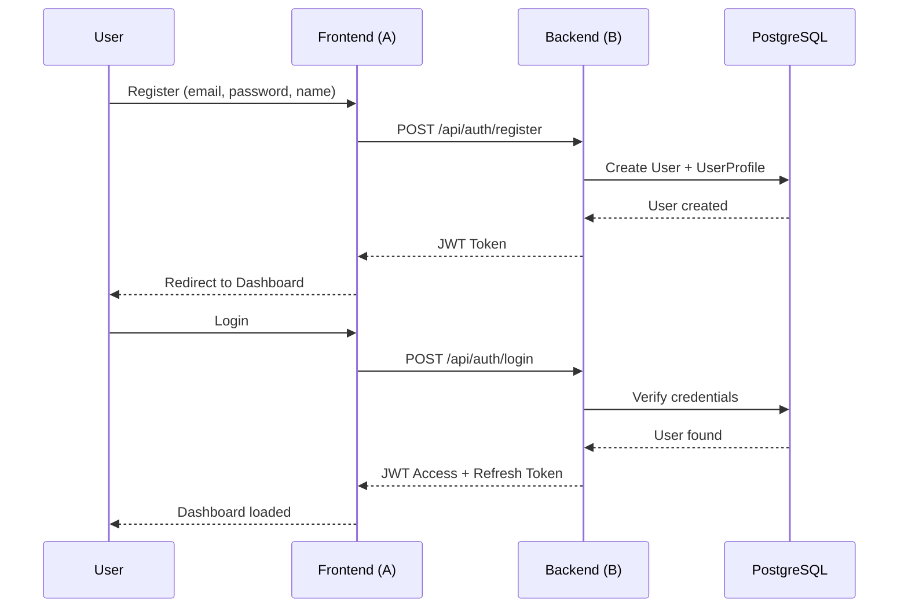
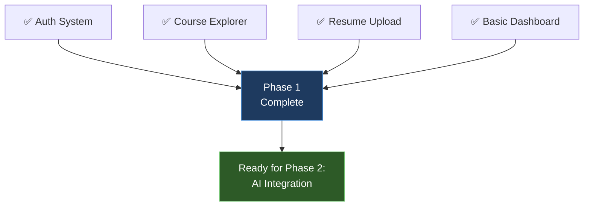
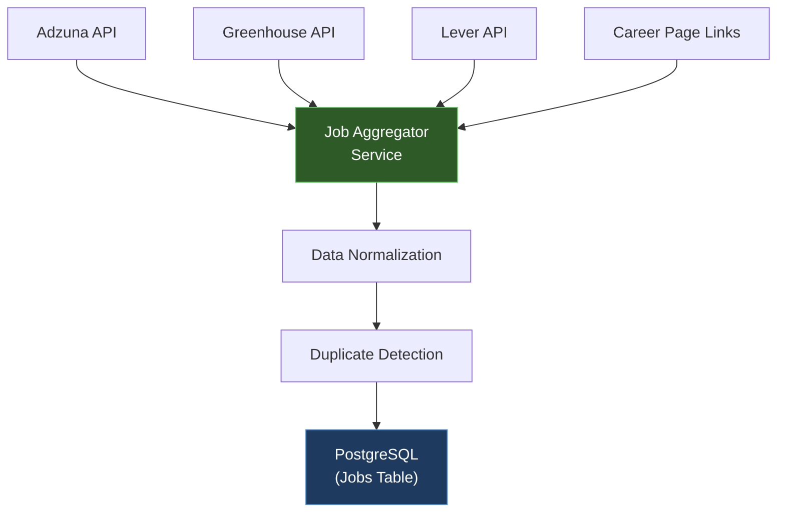
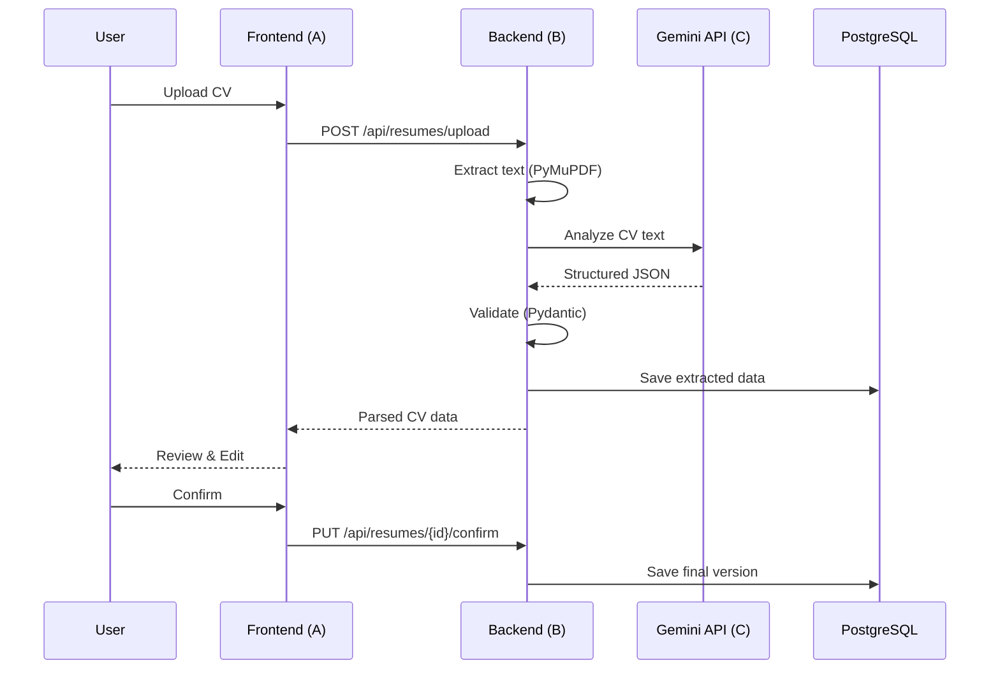
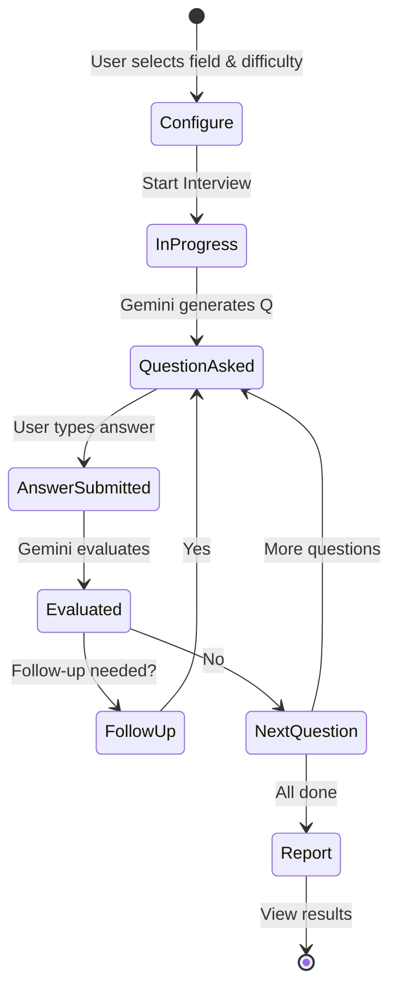
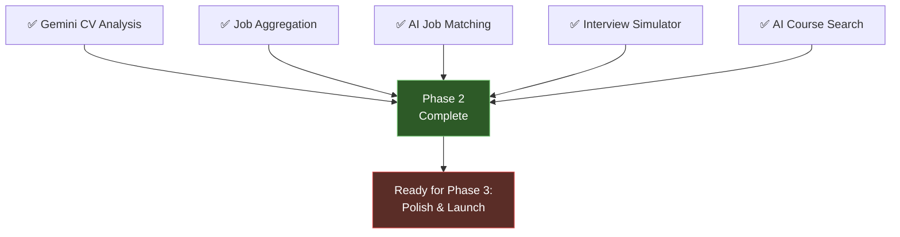
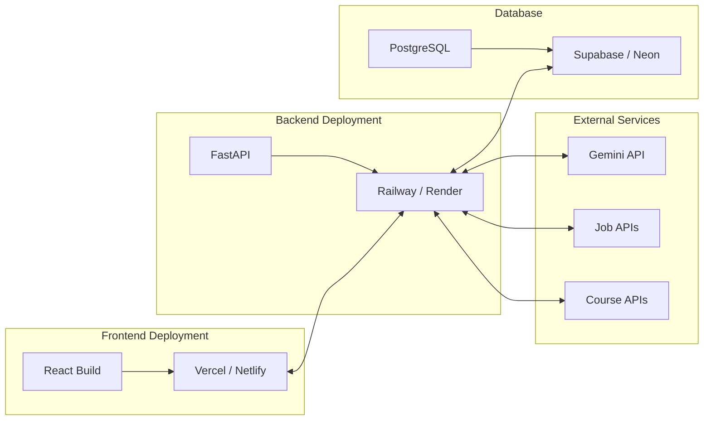
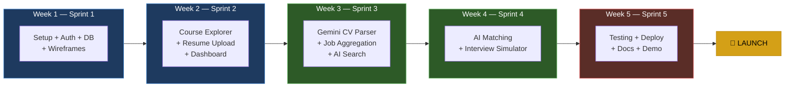

# 🚀 CareerPilot AI — Development Plan (3 Phases / 5 Sprints)

> **AI-Powered Career Development Platform**
> Find Courses · Discover Opportunities · Prepare for Interviews

---

## 📋 Project Overview

| Item | Details |
|------|---------|
| **Deadline** | 5 أسابيع (شهر وأسبوع) |
| **Team Size** | 3 أعضاء |
| **Methodology** | Agile — Weekly Sprints |
| **Sprint Duration** | أسبوع واحد لكل Sprint |
| **Total Sprints** | 5 Sprints |
| **Ceremonies** | Daily Standup (15 min) · Sprint Planning (Monday) · Sprint Review (Friday) |



---

## 👥 Team Structure (3 Members)

| Member | Role | Responsibilities |
|--------|------|-----------------|
| **Member A** | **Frontend Developer** | React.js, Tailwind CSS, UI/UX, pages, responsive design |
| **Member B** | **Backend Developer** | FastAPI, PostgreSQL, SQLAlchemy, Auth, APIs, deployment |
| **Member C** | **AI/ML & Integration** | Gemini API, CV parsing, matching engine, interview engine, external APIs (Adzuna, Greenhouse, Lever) |

> [!IMPORTANT]
> كل عضو مسؤول عن domain بتاعه، لكن لازم الكل يكونوا فاهمين الـ API Contracts عشان الربط يكون سلس. الـ API contracts بتتحدد في Sprint Planning كل أسبوع.

---

## 🔄 Agile Workflow



| Ceremony | متى | المدة | الهدف |
|----------|------|-------|-------|
| **Sprint Planning** | Monday | 1 ساعة | تحديد مهام الأسبوع وتوزيعها |
| **Daily Standup** | يومياً | 15 دقيقة | إيه اللي اتعمل؟ إيه الخطة؟ فيه blockers؟ |
| **Sprint Review** | Friday | 30 دقيقة | Demo لكل اللي اتعمل في الـ Sprint |
| **Retrospective** | Friday | 15 دقيقة | إيه اللي مشي كويس؟ إيه اللي نحسنه؟ |

---

## Project Structure

```
📁 careerpilot-ai/
├── 📁 frontend/          # React.js + Tailwind
│   ├── src/
│   │   ├── components/
│   │   ├── pages/
│   │   ├── hooks/
│   │   ├── services/     # API client layer
│   │   └── store/
│   └── package.json
├── 📁 backend/           # FastAPI + Python
│   ├── app/
│   │   ├── api/          # Route handlers
│   │   ├── core/         # Config, security, deps
│   │   ├── models/       # SQLAlchemy models
│   │   ├── schemas/      # Pydantic schemas
│   │   ├── services/     # Business logic
│   │   │   ├── courses/
│   │   │   ├── jobs/
│   │   │   ├── interviews/
│   │   │   └── ai/       # Gemini integration
│   │   └── utils/
│   ├── migrations/       # Alembic
│   └── requirements.txt
└── 📁 docs/
```

---

# Phase 1 — Foundation & Core Infrastructure
## 📅 Sprints 1–2 (أسبوعين)

> [!IMPORTANT]
> Phase 1 هي الأساس. لازم Auth + Database + Course Explorer + Resume Upload يكونوا شغالين قبل ما ندخل على الـ AI.

---

## Sprint 1 — Setup, Auth & Database
### 📅 Week 1

### Sprint Goal
> تأسيس المشروع بالكامل: project setup, database, authentication, user profiles, و بداية الـ Course Explorer.

| Task | Owner | Priority | Story Points |
|------|-------|----------|-------------|
| SRS Document + ERD + System Architecture | **Team** | 🔴 Critical | 5 |
| UI/UX Wireframes (Figma) لكل الصفحات | **A** | 🔴 Critical | 5 |
| Git repo + project scaffold (frontend + backend) | **B** | 🔴 Critical | 3 |
| PostgreSQL setup + Alembic migrations | **B** | 🔴 Critical | 3 |
| Database models: `Users`, `UserProfiles`, `Courses`, `CourseCategories`, `SavedCourses` | **B** | 🔴 Critical | 5 |
| Auth system: Register, Login, JWT (access + refresh) | **B** | 🔴 Critical | 5 |
| Password hashing (Bcrypt) + auth middleware | **B** | 🟡 High | 3 |
| Frontend: Login/Register pages + auth context + protected routes | **A** | 🔴 Critical | 5 |
| Frontend: Sidebar layout + Dashboard skeleton | **A** | 🟡 High | 3 |
| Course data source research + API keys setup | **C** | 🟡 High | 3 |
| Course API integration (fetch + normalize + store) | **C** | 🟡 High | 5 |
| Gemini API key setup + basic service layer scaffold | **C** | 🟢 Medium | 2 |



### Sprint 1 — Definition of Done
- [x] المستخدم يقدر يعمل Register و Login
- [x] JWT authentication شغال
- [x] Database schema جاهز ومتنفذ
- [x] Frontend layout (sidebar + pages skeleton) جاهز
- [x] Course data بتتجمع من مصدر واحد على الأقل
- [x] Wireframes لكل الصفحات موجودة

---

## Sprint 2 — Course Explorer, Resume Upload & Dashboard
### 📅 Week 2

### Sprint Goal
> إكمال Course Explorer بالكامل + Resume Upload + Dashboard أساسي. بنهاية الـ Sprint ده، المستخدم يقدر يبحث عن كورسات ويرفع CV.

| Task | Owner | Priority | Story Points |
|------|-------|----------|-------------|
| Course Search API: `GET /api/courses/search` مع filters | **B** | 🔴 Critical | 5 |
| Course Details API: `GET /api/courses/{id}` | **B** | 🟡 High | 2 |
| Save/Unsave Course: `POST/DELETE /api/courses/{id}/save` | **B** | 🟡 High | 2 |
| Resume upload API: validation, file storage, text extraction (PyMuPDF + python-docx) | **B** | 🔴 Critical | 5 |
| Database models: `Resumes`, `ResumeSkills`, `Skills`, `SavedCourses` | **B** | 🔴 Critical | 3 |
| Frontend: Explore Courses page (search bar, filters, course cards, pagination) | **A** | 🔴 Critical | 5 |
| Frontend: Course Details page + Save button | **A** | 🟡 High | 3 |
| Frontend: My Resume page (upload, preview, delete) | **A** | 🔴 Critical | 5 |
| Frontend: Dashboard page (welcome, profile info, resume status) | **A** | 🟡 High | 3 |
| Frontend: Saved Courses page | **A** | 🟢 Medium | 2 |
| Course data: add more sources + data normalization pipeline | **C** | 🟡 High | 5 |
| Gemini service layer: error handling, rate limiting, retry logic | **C** | 🟡 High | 5 |
| Database models for Phase 2 prep: `Jobs`, `JobSkills`, `JobSources` | **C** | 🟢 Medium | 3 |

> [!NOTE]
> في Sprint 2 البحث عن الكورسات هيكون **Traditional Search** (keyword + filters). الـ AI-Powered Natural Language Search هيتضاف في Phase 2.

### Sprint 2 — Definition of Done
- [x] Course Explorer شغال بالكامل (search + filters + details + save)
- [x] CV upload شغال (PDF + DOCX) مع text extraction
- [x] Dashboard أساسي بيعرض بيانات المستخدم
- [x] Gemini service layer جاهز للاستخدام في Phase 2
- [x] كورسات من مصادر متعددة متخزنة في الـ DB

---

### ✅ Phase 1 Milestone



**عند نهاية Phase 1 المستخدم يقدر:**
- ✅ يسجل ويدخل حسابه
- ✅ يبحث عن كورسات ويحفظها
- ✅ يرفع الـ CV بتاعه
- ✅ يشوف Dashboard أساسي
- ❌ مفيش AI لسه — كل حاجة بـ traditional logic

---

# Phase 2 — AI Intelligence & Smart Features
## 📅 Sprints 3–4 (أسبوعين)

> [!IMPORTANT]
> Phase 2 هي قلب المشروع — هنا بندخل Gemini في كل حاجة وبنبني الـ Features اللي بتميز CareerPilot.

---

## Sprint 3 — Gemini CV Analysis + Job Aggregation
### 📅 Week 3

### Sprint Goal
> تشغيل Gemini لتحليل الـ CV + تجميع الوظائف من APIs متعددة + بداية AI Course Search.

| Task | Owner | Priority | Story Points |
|------|-------|----------|-------------|
| AI CV Parser: إرسال CV text لـ Gemini → structured JSON | **C** | 🔴 Critical | 5 |
| Pydantic validation لـ Gemini CV output | **C** | 🔴 Critical | 3 |
| AI Natural Language Course Search (Gemini → filters → search) | **C** | 🟡 High | 5 |
| Course summarization + skills extraction via Gemini | **C** | 🟢 Medium | 3 |
| Adzuna API integration (job search) | **C** | 🔴 Critical | 5 |
| Greenhouse Job Board API integration | **C** | 🟡 High | 3 |
| Job Aggregator service: fetch → normalize → deduplicate → store | **B** | 🔴 Critical | 5 |
| Database: `Jobs`, `JobSkills`, `JobSources`, `SavedJobs`, `JobMatches` tables | **B** | 🔴 Critical | 3 |
| Job Search API: `GET /api/jobs/search` مع filters | **B** | 🔴 Critical | 5 |
| Save Job + Application tracking APIs | **B** | 🟡 High | 3 |
| Background job fetching (scheduled task) | **B** | 🟢 Medium | 3 |
| Frontend: CV analysis review/edit page | **A** | 🔴 Critical | 5 |
| Frontend: Find Jobs page (job cards, filters, source badge) | **A** | 🔴 Critical | 5 |
| Frontend: Job Details page | **A** | 🟡 High | 3 |
| Frontend: Update Course Search مع AI search option | **A** | 🟡 High | 3 |





### Sprint 3 — Definition of Done
- [x] Gemini CV parsing شغال ومتحقق منه
- [x] User review/edit flow للـ CV data
- [x] وظائف بتتجمع من Adzuna + Greenhouse على الأقل
- [x] Job search مع filters شغال
- [x] AI-powered course search شغال

---

## Sprint 4 — AI Job Matching + Interview Simulator
### 📅 Week 4

### Sprint Goal
> تشغيل AI Job Matching Engine + Interview Simulator بالكامل. بنهاية الـ Sprint ده، الـ 3 Features الأساسية هيكونوا شغالين.

| Task | Owner | Priority | Story Points |
|------|-------|----------|-------------|
| Skill Matching Algorithm (CV skills vs job requirements) — 40% weight | **C** | 🔴 Critical | 5 |
| Experience & Projects scoring — 25% weight | **C** | 🔴 Critical | 3 |
| Semantic Similarity (Sentence Transformers) — 20% weight | **C** | 🟡 High | 5 |
| Education & Eligibility matching — 15% weight | **C** | 🟡 High | 2 |
| Match explanation via Gemini (why it matches + missing skills) | **C** | 🟡 High | 3 |
| Interview question generation via Gemini | **C** | 🔴 Critical | 5 |
| Answer evaluation + scoring via Gemini | **C** | 🔴 Critical | 5 |
| Follow-up questions logic | **C** | 🟢 Medium | 3 |
| Interview APIs: session management, Q&A flow, reports | **B** | 🔴 Critical | 5 |
| Database: `InterviewSessions`, `InterviewQuestions`, `InterviewResponses`, `InterviewReports` | **B** | 🔴 Critical | 3 |
| Job Matching API: `GET /api/jobs/matched` | **B** | 🔴 Critical | 3 |
| Missing skills → course recommendations logic | **B** | 🟡 High | 3 |
| Lever API integration (additional job source) | **B** | 🟢 Medium | 3 |
| Frontend: Job cards مع match score + match breakdown | **A** | 🔴 Critical | 5 |
| Frontend: Interview Setup page (field, difficulty, type, count) | **A** | 🔴 Critical | 3 |
| Frontend: Interview Q&A flow page | **A** | 🔴 Critical | 5 |
| Frontend: Interview Report page | **A** | 🔴 Critical | 5 |
| Frontend: Interview History page | **A** | 🟡 High | 3 |
| Frontend: My Applications page | **A** | 🟢 Medium | 3 |

```
┌─────────────────────────────────────────────────┐
│              AI Job Matching Engine              │
├─────────────────────────────────────────────────┤
│                                                 │
│  Student CV Data          Job Requirements      │
│  ┌─────────────┐         ┌──────────────┐      │
│  │ Skills      │◄───────►│ Required     │ 40%  │
│  │ Projects    │◄───────►│ Experience   │ 25%  │
│  │ Description │◄───────►│ Description  │ 20%  │
│  │ Education   │◄───────►│ Eligibility  │ 15%  │
│  └─────────────┘         └──────────────┘      │
│              │                  │                │
│              ▼                  ▼                │
│         ┌──────────────────────────┐            │
│         │   Match Score: 87%       │            │
│         │   ✅ Python, ML, Pandas  │            │
│         │   ❌ Missing: Docker,SQL │            │
│         │   💡 Suggested Courses   │            │
│         └──────────────────────────┘            │
└─────────────────────────────────────────────────┘
```



### Sprint 4 — Definition of Done
- [x] AI Job Matching شغال مع match scores
- [x] Match explanations + missing skills ظاهرة
- [x] Interview Simulator كامل (setup → Q&A → report)
- [x] Follow-up questions شغالة
- [x] Interview history متحفظة
- [x] **الـ 3 Core Features كلهم شغالين** ✅

---

### ✅ Phase 2 Milestone



**عند نهاية Phase 2:**
- ✅ الـ 3 Features الأساسية شغالين بالكامل
- ✅ Gemini متكامل مع CV parsing, course search, job matching, interviews
- ✅ Job Aggregator بيجمع وظائف من مصادر متعددة
- ✅ المنصة functional — محتاجة testing و polish

---

# Phase 3 — Testing, Polish & Launch
## 📅 Sprint 5 (أسبوع واحد)

> [!CAUTION]
> آخر أسبوع! لازم نكون مركزين على الـ bugs الحرجة والـ deployment. أي feature جديدة **ممنوعة** في الـ Sprint ده.

## Sprint 5 — Testing, Deployment & Documentation
### 📅 Week 5

### Sprint Goal
> تسليم مشروع مستقر، متختبر، deployed، وموثق بالكامل.

| Task | Owner | Priority | Story Points |
|------|-------|----------|-------------|
| **Testing** | | | |
| Unit tests: Auth, Course, Resume services | **B** | 🔴 Critical | 5 |
| Unit tests: Job aggregation, matching engine | **C** | 🔴 Critical | 5 |
| API integration tests (Postman collection) | **B** | 🔴 Critical | 3 |
| AI output validation tests (Gemini responses) | **C** | 🔴 Critical | 3 |
| Security tests: data isolation, JWT, file access, API key safety | **B** | 🔴 Critical | 3 |
| Edge cases: empty CV, malformed files, Gemini failures, rate limits | **C** | 🟡 High | 3 |
| Frontend testing: user flows, error states | **A** | 🟡 High | 3 |
| **Bug Fixing** | | | |
| Fix all critical bugs from testing | **Team** | 🔴 Critical | 5 |
| **UI Polish** | | | |
| Responsive design verification | **A** | 🔴 Critical | 3 |
| Loading states, error messages, empty states | **A** | 🟡 High | 3 |
| Dashboard: recommended jobs, courses, interview stats | **A** | 🟡 High | 3 |
| **Deployment** | | | |
| Frontend deploy (Vercel / Netlify) | **A** | 🔴 Critical | 2 |
| Backend deploy (Railway / Render) | **B** | 🔴 Critical | 3 |
| PostgreSQL cloud instance (Supabase / Neon) | **B** | 🔴 Critical | 2 |
| Production `.env`, CORS, rate limiting | **B** | 🔴 Critical | 2 |
| **Documentation** | | | |
| API docs (Swagger auto-generated) | **B** | 🟡 High | 1 |
| README + setup guide | **Team** | 🟡 High | 2 |
| **Demo** | | | |
| Demo script + sample data preparation | **Team** | 🔴 Critical | 3 |
| Final project demo | **Team** | 🔴 Critical | — |



### Testing Coverage

| Area | Key Tests |
|------|-----------|
| **Auth** | Register, login, invalid credentials, token expiry, refresh |
| **Courses** | Search, filters, save/unsave, empty results, AI search |
| **Resume** | Upload valid/invalid files, text extraction, AI parsing, edit |
| **Jobs** | API integration, aggregation, dedup, matching, filters |
| **Interview** | Config, Q generation, evaluation, follow-up, report |
| **Security** | User data isolation, file access control, JWT validation |

### Sprint 5 — Definition of Done
- [x] All critical bugs fixed
- [x] App deployed and accessible online
- [x] API documentation complete
- [x] README + setup guide written
- [x] Demo script ready
- [x] **Project delivered** 🚀

---

## 📊 Full Plan Summary

| | Phase 1 | Phase 2 | Phase 3 |
|---|---------|---------|---------|
| **Sprints** | 1–2 | 3–4 | 5 |
| **Duration** | أسبوعين | أسبوعين | أسبوع |
| **Focus** | Foundation & Core | AI Intelligence | Polish & Launch |
| **Key Deliverables** | Auth, DB, Course Explorer, Resume Upload, Dashboard | Gemini CV, Job Aggregation, AI Matching, Interviews | Testing, Deployment, Docs, Demo |
| **AI Usage** | ❌ None | ✅ Full Gemini | 🔧 Validation only |
| **Risk** | Low | High | Medium |

---

## 👥 Member Responsibilities per Sprint

| Sprint | Member A (Frontend) | Member B (Backend) | Member C (AI/Integration) |
|--------|--------------------|--------------------|--------------------------|
| **S1** | Auth UI, Layout, Wireframes | Project setup, DB, Auth system | Course data sources, Gemini setup |
| **S2** | Course pages, Resume UI, Dashboard | Course APIs, Resume upload, Filters | Course integration, Gemini service layer, Job DB prep |
| **S3** | CV review page, Job pages, AI search UI | Job aggregator, Job APIs, Save/Apply | Gemini CV parser, AI search, Adzuna + Greenhouse |
| **S4** | Match UI, Interview pages, History | Interview APIs, Matching API, Lever | Matching engine, Interview AI, Follow-ups |
| **S5** | UI polish, Responsive, Frontend deploy | Tests, Security, Backend deploy, Docs | AI tests, Edge cases, Bug fixes, Demo |

---

## ⚠️ Key Risks & Mitigations

| Risk | Impact | Mitigation |
|------|--------|------------|
| **Timeline ضيق (5 أسابيع)** | Features ممكن متكملش | الأولوية للـ Core Features فقط. أي nice-to-have يتأجل |
| **Gemini API rate limits** | يوقف AI features | Cache responses, minimize calls, fallback messages |
| **Job API data quality** | بيانات ناقصة/مكررة | Validation + dedup pipeline |
| **CV parsing accuracy** | بيانات غلط في matching | User review/edit step + Pydantic validation |
| **3 أعضاء بس** | ضغط على كل واحد | توزيع واضح + daily standup لحل الـ blockers بسرعة |
| **API key exposure** | Security breach | `.env` files, server-side only, never in frontend |

> [!CAUTION]
> **بيانات الـ CV**: خلال التطوير، استخدموا CVs تجريبية. لا ترسلوا CVs حقيقية لـ Gemini Free Tier في production بدون مراجعة سياسات الخصوصية.

---

## 📅 Timeline View


